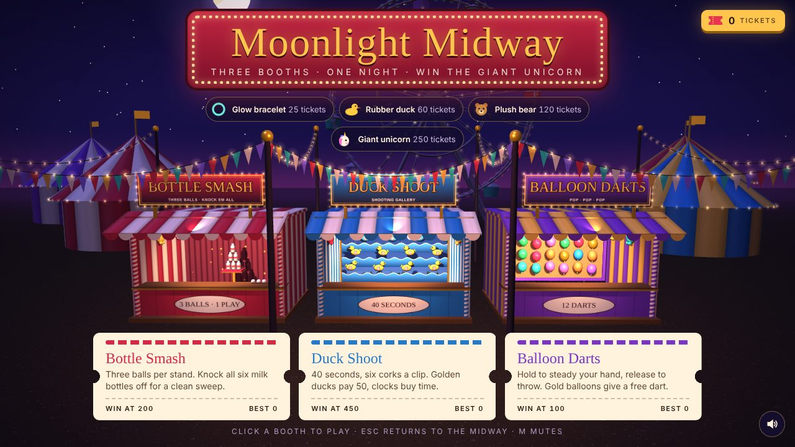
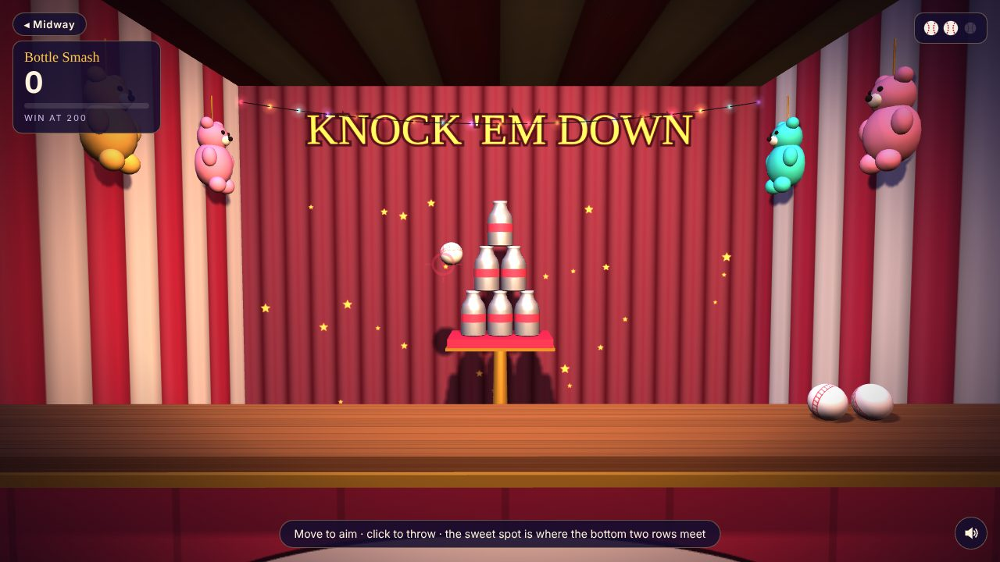
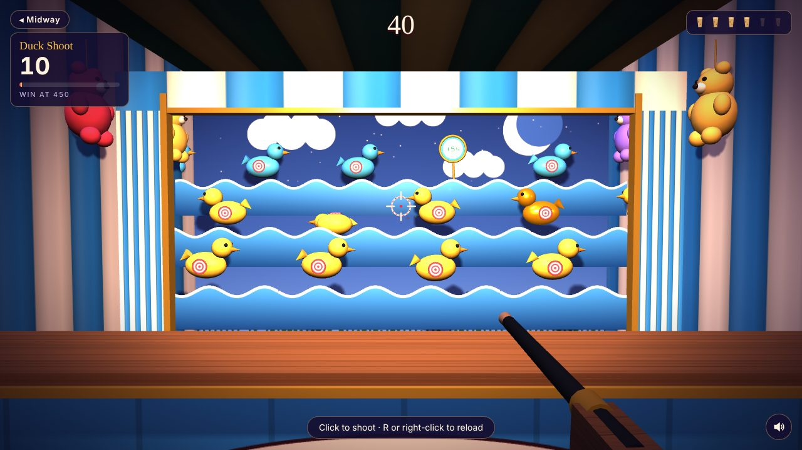
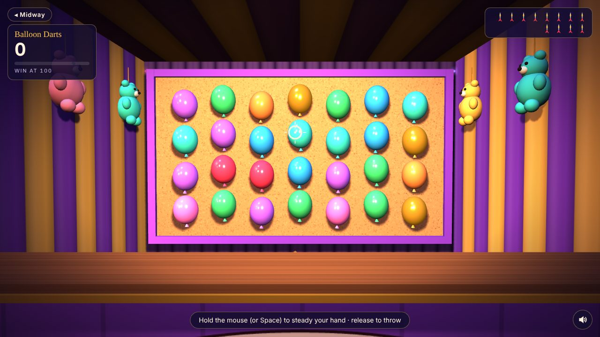

# Moonlight Midway

A 3D night carnival that runs in the browser. Walk up to three booths (Bottle Smash, Duck Shoot and Balloon Darts), win tickets, and work your way up the prize ladder to the giant unicorn.



There's no build step and no install. Open `index.html` and play.

## The games

| | Booth | How it works | Win at |
|---|---|---|---|
|  | **Bottle Smash** | Three rounds of three balls against a 3-2-1 stack of milk bottles. Knock all six off the stand for a clean sweep (+50, plus 25 for each ball you didn't need). The aim sways more each round. Hit where the bottom two rows meet. | 200 |
|  | **Duck Shoot** | 40 seconds with a cork gun and six corks a clip. Yellow ducks pay 10, blue 20, golden 50. Clock targets add 5 seconds (15 at most). Every five hits in a row raise the multiplier, up to x3. | 450 |
|  | **Balloon Darts** | 12 darts at a board of 28 balloons. Hold to steady your hand, then release to throw. Hold too long and your arm starts to shake. Gold balloons pay 30 and give back a dart. Three pops in a row is a hat trick (+20). | 100 |

Every run earns one ticket per 10 points, plus 15 if you beat the goal. Tickets unlock the glow bracelet (25), rubber duck (60), plush bear (120) and giant unicorn (250). Tickets and best scores are saved in your browser's local storage.

## Controls

| | |
|---|---|
| **Mouse / touch** | Aim. Click or tap to throw or shoot |
| **Hold**, then release | Balloon Darts: steady your aim, then throw |
| **Space** | Throw or shoot (hold it in Balloon Darts) |
| **R** / right-click | Duck Shoot: reload |
| **Esc** | Back to the midway |
| **M** | Mute |

## Running it

- **Locally:** double-click `index.html`. It works straight from the file system. If you'd rather use a local server, run `npm start`, which uses `npx serve`.
- **GitHub Pages:** push the repo, then go to **Settings → Pages**. Choose *Deploy from a branch*, select `main`, and choose `/ (root)`. The game will be live at `https://<you>.github.io/<repo>/`.

The page loads three.js and cannon.js from cdnjs and the Rye and Fredoka fonts from Google Fonts, so you need an internet connection the first time.

## How it's built

- **three.js r128** renders the scene. **cannon.js 0.6.2** handles the bottle physics.
- **No image or audio files.** Every texture (awnings, wood, cork, the painted lake, signs) is drawn on a 2D canvas at startup. The calliope waltz and all sound effects are synthesized live with the Web Audio API.
- **No bundler.** The scripts are plain `<script>` tags that share top-level names. That's why opening the file directly works, but it also means the load order in `index.html` matters.

```
index.html              markup and script order
css/style.css           UI: marquee, ticket cards, HUD, result card
js/core.js              helpers, storage, renderer, scene, camera
js/textures.js          canvas texture painters
js/effects.js           carnival bulbs, particles, geometry helpers
js/midway.js            sky, ferris wheel, tents, string lights, booths
js/audio.js             Web Audio music and sound effects
js/ui.js                HUD, banners, floating score popups
js/games/shared.js      reticle and aiming helpers, plus the game interface
js/games/bottle-smash.js
js/games/duck-shoot.js
js/games/balloon-darts.js
js/main.js              game flow, tickets, camera, input, render loop
test/smoke.test.js      headless playthrough test
```

Each booth game is a constructor with the same interface (`start`, `stop`, `update`, `down`, `up`, `key`, plus `name`, `goal` and camera framing), described in `js/games/shared.js`. Adding a fourth booth means three steps: build its set in a new file, add its booth in `midway.js`, and add it to the `games` list in `main.js`.

## Testing

```sh
npm install
npm test
```

The smoke test loads every script in a Node `vm` context with a stubbed DOM and a no-op renderer. Bots then play each booth to its result screen and back. It catches runtime errors, broken game flow and scoring regressions. It doesn't check rendering, so open the page in a browser for that. GitHub Actions runs the test on every push and pull request.

## Credits

Released under the [MIT License](LICENSE). Fonts: [Rye](https://fonts.google.com/specimen/Rye) and [Fredoka](https://fonts.google.com/specimen/Fredoka), both under the SIL Open Font License, served by Google Fonts. Libraries: [three.js](https://threejs.org) (MIT) and [cannon.js](https://github.com/schteppe/cannon.js) (MIT).
